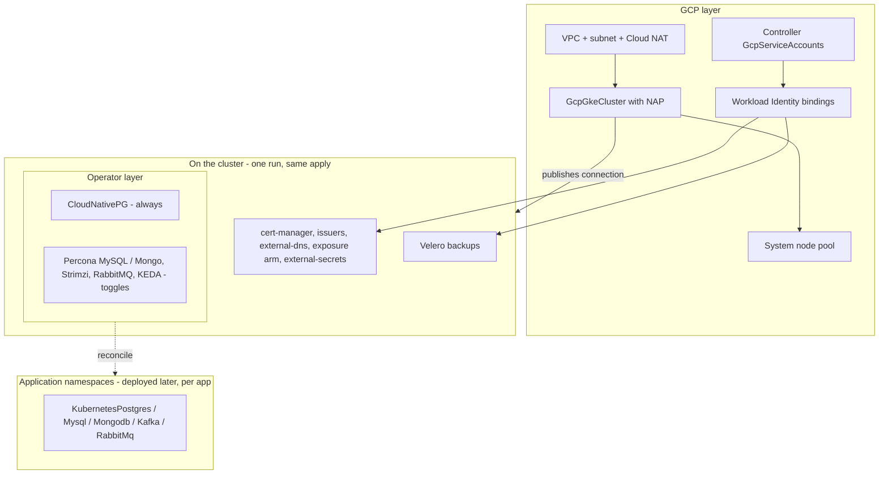

# GCP GKE Full Stack Platform

The GKE cluster your full-stack applications land on — operators included.
Everything in the GCP GKE Baseline (a production regional cluster that
provisions its own machines through node auto-provisioning, consolidates
them when idle, and backs itself up, with TLS, DNS, ingress, and secrets
syncing wired keylessly), plus the cluster-resident operator layer that
application data services ride: PostgreSQL unconditionally, with MySQL,
MongoDB, Kafka, RabbitMQ, and KEDA one toggle away each.

**The operator-aware doctrine this chart teaches:** the CLUSTER carries the
operators — one per engine, watching every namespace; APPLICATIONS declare
their own databases, caches, brokers, and topics in their own namespaces
(directly, or through the app-data-services chart), against this cluster's
connection. Operators install once; data services multiply per app. That
split is why this chart and its sibling baseline exist as a pair: "minimal
cluster" vs "app-ready cluster" is how platform teams actually decide.

This is a ONE-RUN composition: the cluster publishes its Kubernetes
connection under `cluster_connection_name` and every Kubernetes resource in
the chart consumes it. Deploy at most once per environment — it owns
cluster-wide singletons (cert-manager, external-secrets, the default
IngressClass, and every operator here).

## What it deploys

Everything in the baseline:

| Layer | Resources |
|---|---|
| Network | GcpVpcNetwork (custom mode), GcpSubnetwork (node range + named pod/service secondary ranges), GcpRouterNat (Cloud Router + NAT — private-node egress) |
| Cluster | GcpServiceAccount (least-privilege node identity), GcpGkeCluster (regional, Dataplane V2, private nodes, node auto-provisioning; publishes the connection), system GcpGkeNodePool, scale-to-zero Spot pool (toggle), a `default` KubernetesGkeComputeClass that falls back across machine families during a stockout (toggle: `default_compute_class_enabled`) |
| Keyless identity | A GcpServiceAccount + GcpGkeWorkloadIdentityBinding pair per controller: cert-manager, external-dns, external-secrets, Velero — no cluster output needed, no key anywhere |
| Addon spine | cert-manager + Let's Encrypt prod/staging ClusterIssuers (keyless Cloud DNS DNS-01), external-dns (Cloud DNS), ingress-nginx XOR the native GKE Gateway, external-secrets + GCP Secret Manager ClusterSecretStore (toggle) |
| Backups | GCS bucket (versioned, public access enforced off, bucket-scoped grant), the Velero custom role + project grant, the Velero VolumeSnapshotClass, Velero with a daily schedule (toggle) |

(GKE itself provides metrics-server, the CSI drivers and StorageClass, the
snapshot controller, managed Prometheus, and — with the gateway arm — the
Gateway API CRDs, controller, and classes; the baseline README's opening
section explains each.)

Plus the operator layer:

| Resource | Kind | Purpose | Conditional on |
|---|---|---|---|
| `<env>-cnpg` | KubernetesCloudNativePgOperator | PostgreSQL databases in any namespace (cluster-wide watch) | — (Postgres is the standard) |
| `<env>-percona-mysql` | KubernetesPerconaMysqlOperator | Galera-replicated MySQL per app (cluster-wide watch) | `mysql_operator_enabled` |
| `<env>-percona-mongo` | KubernetesPerconaMongoOperator | MongoDB replica sets per app (cluster-wide watch) | `mongodb_operator_enabled` |
| `<env>-strimzi` | KubernetesStrimziKafkaOperator | Kafka clusters/topics/users per app (any-namespace watch) | `kafka_operator_enabled` |
| `<env>-rabbitmq-operator` | KubernetesRabbitMqOperator | RabbitMQ brokers per app (watches all namespaces by default) | `rabbitmq_operator_enabled` |
| `<env>-keda` | KubernetesKeda | Event-driven autoscaling, including to/from zero | `keda_enabled` |

## Architecture

## Parameters

The baseline's parameters apply unchanged (identity, network, cluster,
capacity, exposure, DNS, certificates, secrets, backups — see each
parameter's description in `values.yaml`; `gcp_project_id`,
`dns_zone_names`, `dns_domains`, and `acme_email` MUST be changed). The
operator layer adds:

| Parameter | Default | When to change |
|---|---|---|
| `mysql_operator_enabled` | `false` | First app that needs MySQL |
| `mongodb_operator_enabled` | `false` | First app that needs MongoDB |
| `kafka_operator_enabled` | `false` | First app that needs Kafka |
| `rabbitmq_operator_enabled` | `false` | First app that needs RabbitMQ |
| `keda_enabled` | `false` | First workload that scales on events |

CloudNativePG has no toggle — a full-stack platform without Postgres is not
one.

## After deployment

1. **Deploy the first data service where the app lives** — declare a
   `KubernetesPostgres` in an application's namespace (or deploy the
   app-data-services chart per app): the resident CNPG operator reconciles
   it there. No per-database operator installs, ever.
2. **Verify the self-provisioning loop** — scale a workload beyond the
   system pool's free capacity and watch node auto-provisioning create a
   pool for it (`kubectl get nodes -w`); scale down and watch it drain.
3. **Issue the first certificate against staging**, then flip the
   `issuerRef` to `<env>-letsencrypt-prod` — staging first protects the
   production rate limit.
4. **Expose the first service** — an Ingress with no class lands on the
   default nginx class; external-dns publishes its DNS record within a
   minute (gateway arm: attach an HTTPRoute to `<env>-gateway` — Google's
   load balancer programs on first use).
5. **Prove restore before you need it** — `velero backup create drill`,
   delete a test namespace, `velero restore create --from-backup drill`.

## Day-2 notes

- **Turning an operator toggle ON later is a plain redeploy** — the layer is
  additive. Turning one OFF removes the operator (its CRDs follow each
  kind's documented keep posture); do it only after the last data service
  using that engine is gone.
- Everything in the baseline's day-2 notes applies unchanged: the NAP
  ceilings as the spend cap, the Spot pool as the cost lever, subnet
  primary-range expansion, deletion protection as the teardown gate, and
  tightening the project-scoped grants.
- **Sizing note**: each enabled operator is a small controller (the system
  pool absorbs them), but the data services they reconcile land on
  auto-provisioned capacity — raise `nap_cpu_max`/`nap_memory_max_gib` as
  the data layer grows.

---

© Planton. Licensed under [Apache-2.0](https://github.com/plantonhq/planton/blob/main/LICENSE).
