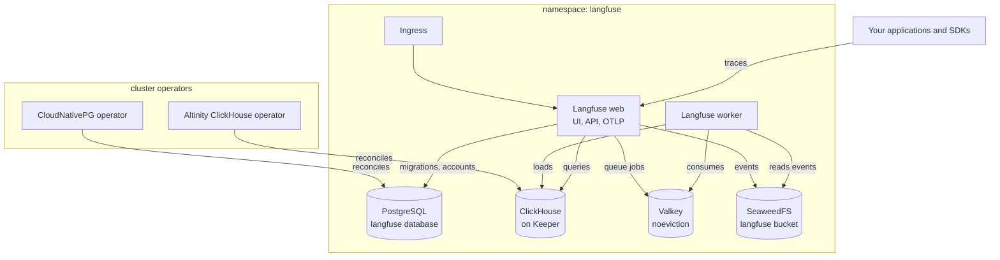

# Kubernetes Self-Hosted Langfuse

Your own Langfuse, the open-source LLM engineering platform for tracing model calls, managing prompts and running evaluations, deployed on your cluster with all four of its stores composed and wired by reference. Langfuse needs Postgres for its accounts and settings, ClickHouse for traces, a Redis-protocol queue that must never evict, and object storage that every event passes through, and getting those four right is most of the work of self-hosting it. This chart encodes that composition: a CloudNativePG PostgreSQL owned by the Langfuse user, a ClickHouse installation on Keeper from day one so it can grow replicas without a data migration, a Valkey queue that refuses writes instead of dropping jobs, and a SeaweedFS bucket, all in one namespace because that is what Kubernetes secret access requires. Every secret is generated or declared as a managed secret and kept out of Helm values, and Langfuse seeds an organization, a project, an API key pair and an admin at first start, so an SDK can send its first trace the moment the deploy finishes.

| Resource | Kind | Purpose | Conditional on |
|---|---|---|---|
| `<env>-langfuse-ns` | KubernetesNamespace | The stack's shared home, owned once and joined by every tenant | always |
| `<env>-cnpg-operator` | KubernetesCloudNativePgOperator | The PostgreSQL engine (one per cluster) in `cnpg-system` | `install_cnpg_operator` |
| `<env>-altinity-operator` | KubernetesAltinityOperator | The ClickHouse engine (one per cluster) in `clickhouse-operator-system`, watching every namespace | `install_altinity_operator` |
| `<env>-langfuse-pg` | KubernetesPostgres | Users, projects, prompts, API keys and settings, in the `langfuse` database | always |
| `<env>-langfuse-ch` | KubernetesClickHouse | Traces, observations and scores, on ClickHouse Keeper | always |
| `<env>-langfuse-valkey` | KubernetesValkey | The ingestion queues and caches, with `noeviction` and an append-only log | always |
| `<env>-langfuse-s3` | KubernetesSeaweedFs | S3-compatible storage for events, media and exports, with the `langfuse` bucket | always |
| `<env>-langfuse` | KubernetesLangfuse | The web server, the worker and the seeded organization, project, key pair and admin | always |
| `<env>-langfuse-ingress` | KubernetesIngress | The public hostname routed to the web Service, with TLS from cert-manager | `hostname` set |

**Prerequisites when an operator toggle is false:** the cluster must already run that operator, and a resident Altinity operator must watch this chart's namespace. With the toggles on, the default, this chart brings both.

## Architecture



Deployment layers: the namespace and the operators deploy first. The database and the ClickHouse installation wait for their operators (explicit dependency edges) and for the namespace (by reference); Valkey and SeaweedFS wait only for the namespace. Langfuse waits for all four stores, because its host and password references are the ordering, and the Ingress waits for Langfuse through its reference to the `service` output. The web server runs the Postgres and ClickHouse migrations when it starts.

## Parameters

| Param | Meaning | Default | Change when |
|---|---|---|---|
| `connection` | Kubernetes connection slug selecting the target cluster | `""` | The environment default is not the cluster you mean |
| `namespace` | Shared home of Langfuse and its stores | `langfuse` | Running a second independent Langfuse on one cluster |
| `install_cnpg_operator` | Bring the CloudNativePG operator | `true` | **Set false** on clusters that already run it: a second install fights the resident one |
| `install_altinity_operator` | Bring the Altinity ClickHouse operator | `true` | **Set false** on clusters that already run it, and make sure it watches this namespace |
| `high_availability` | Redundancy in every tier and production sizing for Langfuse | `false` | Any install people depend on; the data layout is the same either way, so it can be turned on later |
| `postgres_disk_size` | Volume size per PostgreSQL instance | `10Gi` | Rarely: Postgres never holds traces. Grows in place; shrinks are rejected |
| `clickhouse_disk_size` | Volume size per ClickHouse replica | `50Gi` | Trace volume or retention grows; this is the volume that fills |
| `object_storage_disk_size` | Volume size per SeaweedFS volume server | `50Gi` | Media attachments and exports grow |
| `admin_email` | The seeded admin's email and first sign-in name | `admin@example.com` | **Before the first deploy**: Langfuse creates the admin once |
| `salt_secret` | Managed secret holding the API-key salt | `""` (generated) | **Any install you intend to keep**, before the first deploy |
| `encryption_key_secret` | Managed secret holding the 64-hex-character encryption key | `""` (generated) | **Any install you intend to keep**, before the first deploy |
| `hostname` | Public host name Langfuse is served at | `""` (cluster-internal) | Langfuse should be reachable from outside the cluster |
| `ingress_class` | IngressClass that serves the hostname | `nginx` | Your cluster's controller uses another class, or empty for the default class |
| `cluster_issuer` | cert-manager ClusterIssuer for the hostname's certificate | `""` (plain HTTP) | Always, once `hostname` is set on a public network |
| `media_public_endpoint` | Public URL of the SeaweedFS S3 API for presigned URLs | `""` | Media or exports must be reachable from browsers or SDKs outside the cluster |

Names budget: Langfuse's resource name `<env>-langfuse` must stay within 52 characters, so environment names up to 43 characters fit.

## After deployment

1. **Sign in.** Without a `hostname`, open the UI with the Langfuse resource's `port_forward_command` output:

   ```bash
   kubectl -n langfuse port-forward svc/<env>-langfuse-web 3000:3000
   ```

   Browse to http://localhost:3000 and sign in as `admin_email`. The password is in the instance Secret, at the key the `admin_password_secret` output names:

   ```bash
   kubectl -n langfuse get secret <env>-langfuse-secrets \
     -o jsonpath='{.data.init-user-password}' | base64 -d
   ```

2. **Send your first trace.** The seeded project's key pair is ready: the public key is the `project_public_key` output, and the secret key sits in the same Secret at the key `project_secret_key_secret` names (`init-project-secret-key`). Applications in the cluster point a Langfuse SDK at the `endpoint` output (`LANGFUSE_HOST`), or an OpenTelemetry exporter at the `otel_endpoint` output, and their traces show up in the seeded project.

3. **Wire your applications by reference.** In an InfraChart of your own, reference the Langfuse resource's `endpoint`, `project_public_key` and `project_secret_key_secret` outputs from your application's Deployment, so the keys are read from the Secret at runtime and never copied.

4. **Expose it.** Set `hostname` and `cluster_issuer` and point DNS at your ingress controller (or let external-dns do it). Langfuse's external URL follows the hostname, which is what single sign-on redirects and email links need. Then add single sign-on and invite your team from the UI, or configure providers on the deployed KubernetesLangfuse resource.

## Day-2 notes

- **Declare the salt and encryption key before anything is deleted.** Generated values survive every apply, but they live in the Langfuse resource's Secret, while the API-key hashes and encrypted credentials they protect live in Postgres. If an install started with generated values, copy `salt` and `encryption-key` out of `<env>-langfuse-secrets` into managed secrets and set `salt_secret` and `encryption_key_secret` to them. Then a recreate of Langfuse against the surviving database keeps every API key working.
- **Turning on `high_availability` later is safe for data.** ClickHouse already runs replicated tables on Keeper, Postgres adds replicas by streaming, and Valkey and SeaweedFS gain replicas. Growing the Keeper ensemble from one node to three is the step to watch: let the new Keeper nodes join and confirm ClickHouse reconnects before relying on the quorum.
- **Media from outside the cluster needs the S3 API exposed.** Browsers and SDKs upload media and download exports straight from SeaweedFS through presigned URLs. Route the SeaweedFS S3 Service (`<env>-langfuse-s3-s3`, port 8333) at a public host of your own, then set `media_public_endpoint` to it. Event ingestion never needs this.
- **Never let Valkey evict.** The queue store is sized at 1 GB with `noeviction`; if workers fall far behind, Valkey refuses new jobs rather than dropping old ones. Scale the worker on the deployed KubernetesLangfuse resource before raising the memory limit.
- **Backups:** Postgres holds everything that cannot be rebuilt (users, projects, prompts, API keys). The database deploys without object-store backups because CloudNativePG's backup path, the Barman Cloud plugin, needs cert-manager on the cluster. Once it is present, declare a `KubernetesCnpgBarmanCloudPlugin` in the operator's namespace and a `backup` block on the KubernetesPostgres resource. ClickHouse traces can be backed up the same way on the ClickHouse side, or treated as replaceable, depending on how much history you need.
- **Upgrading Langfuse** is a `chartVersion` change on the deployed KubernetesLangfuse resource. The web server runs the new migrations when it starts, inside an atomic Helm upgrade.
- **Expire old events.** Events in the `events/` prefix are only needed until the worker has loaded them into ClickHouse, so expiring them after about 30 days is safe wherever your object store applies prefix lifecycle rules. Never expire `media/`: traces keep pointing at it.

---

© Planton. Licensed under [Apache-2.0](https://github.com/plantonhq/planton/blob/main/LICENSE).
