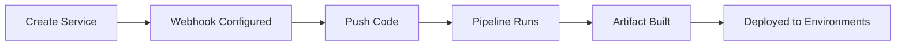

# What is a Service?

Every new backend service requires the same painful CI/CD setup: write pipeline YAML in whatever dialect your CI system uses, configure Docker builds and registry authentication, wire up Kubernetes manifests or ECS task definitions, manage secrets across environments, and hope it all works when someone pushes to main at 2 AM. A developer typically spends two to three days setting up CI/CD for each new service — time not spent building features.

A Service in Planton eliminates this overhead. It is a declaration that connects a Git repository to one or more deployment targets. It is not the application code itself — it is the definition of where code lives, how to build it, where to deploy it, and how to make it accessible. When you create a Service, Planton configures a webhook on your Git provider. From that point forward, every qualifying commit triggers an automated pipeline that builds your code into a deployable artifact and rolls it out to your configured environments.

Think of a Service like a `.vercel.json` file, but for backend applications with multi-environment, multi-cloud deployment support. It captures everything needed to go from source code to running infrastructure — and the complexity of Docker builds, registry authentication, deployment manifests, and deployment orchestration disappears behind a simple declaration.

<!-- SCREENSHOT: Service details overview
  Page: /{org}/service/{slug}
  Action: Show the Overview of a configured service: its repository and latest run, and its environments drawn as the Delivery Path
  Focus: Full page showing the source band and the environment tiles along the Promotion Path
  Alt: Service details page showing the connected repository, the latest run, and each environment's build along its Promotion Path
-->

## The Four Pillars of a Service

Every Service is defined by four configuration areas:

### Where Code Lives

The Git repository configuration points to your repository and defines how the pipeline interacts with it:

- **Repository location**: The organization and repository name on your Git provider (GitHub or GitLab)
- **Default branch**: The primary branch for pipeline triggers
- **Git credential**: Which connection to use for clone and webhook access (see [Connections](/docs/connections/git-providers))
- **Project root**: The subdirectory where service code is located — empty for single-service repositories, a specific path for monorepos
- **Trigger paths**: Additional glob patterns that trigger pipelines beyond changes in the project root
- **Sparse checkout directories**: Directories to fetch during clone, reducing clone times for large repositories

For monorepo configurations — where multiple services share a single repository — the project root, trigger paths, and sparse checkout work together to scope each service to its relevant code. See [Monorepo Support](/docs/ci-cd/monorepo-support) for details.

### How to Build

The pipeline configuration determines how code is transformed into a deployable artifact.

Two pipeline providers are available:

- **Platform-managed**: Planton creates and maintains the pipeline. Choose between Cloud Native Buildpacks (auto-detect language and build without a Dockerfile) or Dockerfile (full control over the build process). No pipeline YAML in your repository.
- **Self-managed**: You write a Tekton pipeline YAML in your repository. Planton executes it and handles deployment orchestration. See [Self-Managed Pipelines](/docs/ci-cd/self-managed-pipelines) for details.

See [Build Methods](/docs/ci-cd/build-methods) for a full explanation of Buildpacks, Dockerfile builds, and image tagging.

### Where to Deploy

Services produce one of two artifact types:

- **Container image**: A Docker container image, deployed to Kubernetes, AWS ECS, GCP Cloud Run, or DigitalOcean App Platform.
- **Cloudflare Worker script**: A JavaScript/TypeScript bundle, deployed to Cloudflare Workers.

Deployment configuration comes from one of two sources:

- **Git-based** (default): The pipeline reads deployment manifests from a `_kustomize` directory in your repository. Kustomize overlays define per-environment configuration. This is the traditional approach for teams that manage deployment configuration in version control.
- **Inline** (UI-based): Deployment targets are defined directly in the Service configuration through the web console. This enables complete service onboarding without creating any deployment files in your repository. Each target specifies an environment, cloud provider, resource type, and resource configuration.

Both paths converge at the same outcome: catalog object manifests that the deploy stage provisions through Planton's infrastructure layer.

See [Deployment Targets](/docs/ci-cd/deployment-targets) for the full list of supported platforms and configuration details.

### How to Reach It

The ingress configuration determines whether a service is publicly accessible:

- **Enabled**: The service is reachable from the internet through a configured DNS domain. Planton creates the appropriate ingress resources (Kubernetes Ingress, load balancer rules, etc.) based on the deployment target.
- **Disabled** (default): The service is deployed but not publicly accessible. This is appropriate for internal services, background workers, and cron jobs.

See [Ingress](/docs/ci-cd/ingress) for DNS domain configuration.

## Service Lifecycle

A Service moves through a predictable lifecycle:



1. **Create**: Define the Service configuration — Git repository, build method, deployment targets, ingress. Planton configures a webhook on your Git provider automatically.
2. **Build**: On each qualifying commit, a pipeline clones the repository, builds the artifact (container image or worker script), and pushes it to the configured registry or storage.
3. **Deploy**: The pipeline deploys the artifact to each configured environment in order, respecting manual approval gates where configured.
4. **Iterate**: Update the Service configuration as requirements change — add environments, switch build methods, adjust trigger paths. Changes take effect on the next pipeline run.

Deleting a Service destroys what it deployed, environment by environment, then removes its history and its record. It is refused up front when a resource it would destroy is marked `planton.dev/prevent-destroy`, has its own deletion protection on, or is still read by something else; a resource marked `planton.dev/keep-on-provider` is released and keeps running. To remove the service but keep everything it deployed, delete with **Keep Resources** (`--retain-infra-components`): each resource is released, as Keep does on an Infra Stack.

While a Service is live, the Infra Components its latest run into an environment planned change only through the service: a direct deploy, destroy, rename or edit of one is refused, naming the service, because its next deploy would undo the change. Change the service's configuration and deploy, or redeploy. Once no run plans a resource, it is free again: you can mark it `planton.dev/keep-on-provider` on its own page before the next deployment lets it go.

## Removing a Resource

A Service's configuration is what runs in your cloud, so taking a resource out of it takes the resource out of the cloud. When a run no longer declares a resource the Service deployed to an environment, the run removes it at the very end, after everything it declares has applied and the rollout has verified. The run lists its removals from the moment it starts, under **No Longer Declared**, so you see what it will remove before it does.

- **Destroyed** is the default, for a database as for a queue. A push that removes a queue's manifest destroys the queue.
- **Kept** (named by its provider: Kept in AWS) applies to a resource marked `planton.dev/keep-on-provider: "true"`: the Service lets go of it and it keeps running, findable and adoptable. Mark it and deploy before removing it.
- **Left in Place** applies when something stops the destroy: `planton.dev/prevent-destroy`, the resource's own deletion protection, something else still reading it, or a kept resource living inside it. The run says why and how to clear it, and the next run tries again.

A push is the declaration itself, as `terraform apply` is: in an unprotected environment it removes what the Service no longer declares without asking, a database too. To keep something running, mark it keep-on-provider and deploy before removing it. In a protected environment the approver sees every removal at the gate, and approving decides them all: each is destroyed unless kept. A removal that appears after the approval asks on its own. If a removal waiting at a gate was a mistake, such as a renamed resource, restore the name and push: the newer run takes over and nothing is removed.

A failed deploy removes nothing, and a removal that fails never fails the deployment: the environment reads "1 removal failed" and the next run tries again. Removing a whole environment from the Service is different: its resources keep running.

Promote, roll back, redeploy and deploy follow the same rule, because each applies a configuration: a rollback destroys what was added after the deployment it restores. Each reads its dry run first: at a terminal it says what it removes and asks, `--yes` answers ahead, and without a terminal it refuses and prints the same command with `--yes` added. A deploy from the Service's own CI is a push, and prints what it removes, then starts. Into a protected environment the approver decides removals at the gate, so the command asks nothing more. Each takes `--dry-run`, which prints what the run would apply and remove without starting it, and the console's confirms show the same answer before you click.

```bash
# What would rolling prod back do? Nothing starts
planton service rollback my-service --env prod --dry-run

# Answer a removal that appeared after a protected gate's approval
planton service removal destroy my-service 131 prod AwsRdsInstance/orders-db
planton service removal keep my-service 131 prod AwsRdsInstance/orders-db
```

## Related Resources

A Service does not operate in isolation. It connects to several other platform resources:

- **Pipeline**: Each pipeline run is triggered by a Service. Pipelines track build and deployment progress per environment.
- **Secret**: Sensitive configuration (API keys, passwords, tokens) stored provider-native in your organization's secret backend. Scoped to organization or environment. Referenced using `$secret/<slug>` syntax (`$secret/@<env>/<slug>` for environment-scoped secrets, with an optional `/<key>` for key-value secrets).
- **Variable / Variable Group**: Non-sensitive configuration (endpoints, feature flags, port numbers). Scoped to organization or environment. Referenced using `$var/<slug>` or `$var/<group>/<entry>` syntax (`$var/@<env>/...` for environment-scoped variables). Both secrets and variables support dynamic references to infrastructure output fields.
- **DNS Domain**: DNS domains configured for ingress. A Service's ingress references a DNS domain resource for routing.
- **Tekton Pipeline**: Reusable pipeline definitions registered in the Tekton hub. Referenced by self-managed pipeline configurations.

See [Secrets](/docs/secrets) for configuration management.

## Using the Web Console

The web console provides a guided wizard for creating services:

1. **Package type**: Choose between container image and Cloudflare Worker script.
2. **Build configuration**: Select a build method (Buildpacks or Dockerfile), configure the container registry, and set pipeline branch triggers.
3. **Deployment configuration**: Choose between Git-based and inline deployment, then add deployment targets per environment — select the cloud provider, resource type, and optionally enable manual approval.

<!-- SCREENSHOT: Service creation wizard
  Page: /orgs/{org}/services/new (deploy wizard)
  Action: Show the deployment configuration step with at least one target added
  Focus: The AddTargetModal showing environment, provider, and kind selection
  Alt: Service creation wizard showing deployment target configuration with environment name, cloud provider, and resource kind selection
-->

After creation, the service's page has these tabs:

- **Overview**: the repository and the latest run, then the **Delivery Path** — each environment along your organization's Promotion Paths, one row per path, with the build it runs, how far it is from the environment it is compared with ("3 commits behind dev"), and any run moving into it, live. **Promote** sits on the step between two stages, and a build is promoted only between stages of the same path. See [Deployment Environments](/docs/ci-cd/deployment-environments#where-each-environment-stands-the-delivery-path).
- **Deployments**: each environment's deployment history, with **Roll Back** and **Roll Back to This** beside the records they restore, and on each environment **Redeploy** (apply what runs there again, putting back anything changed outside Planton) and **Check for Drift** (compare what runs with the cloud; the result shows on each environment as In Sync or Drifted).
- **Runs**: every run, newest first — Planton's runs by number ("Run #128") and the repository's own CI runs by workflow — updating live, with the **Run** button.
- **Configuration**: the environments the service deploys to, build triggers, deploy settings, and the switches that pause builds or deployments.
- **Activity**: every deploy, promotion, rollback and configuration change, with who made it.
- **Map**: what the service is deployed as, in which accounts and environments, with live status on every resource.

## Using the CLI

```bash
# Register (or update) a service from its service.yaml; the whole manifest is validated before anything is sent
planton service register -f service.yaml

# Read the stored record back (YAML, or -o json)
planton service get my-service

# See how the local service.yaml differs from the stored record before registering it
planton diff -f service.yaml

# Deploy an image you built into one environment, from the service's configuration
planton service deploy my-service --env dev --image ghcr.io/acme/my-service:1.4.2

# The same, but from the _kustomize overlay in the folder you are standing in
planton service deploy my-service --env dev --image ghcr.io/acme/my-service:1.4.2 --from-tree

# Where each environment stands: its build, rollout, distance, and runs in flight
planton service status my-service

# Everything that ran for a service, newest first
planton service runs my-service

# Read one run by its number within the service (or by its id)
planton service logs my-service 128

# Start a build by hand
planton service run my-service --branch main

# Release a tag by hand, exactly as if it had just been pushed
planton service run my-service --tag v1.4.0

# View deployment history
planton service deployments my-service

# Promote what runs in dev to the next stage on its path (name --to to pick one); roll staging back
planton service promote my-service --from dev
planton service promote my-service --from dev --to staging
planton service rollback my-service --env staging

# Was anything in prod changed outside Planton? Put it back
planton service drift check my-service --env prod
planton service redeploy my-service --env prod
```

## Related Documentation

- [Build Methods](/docs/ci-cd/build-methods) — Buildpacks, Dockerfile, and image tagging
- [Pipelines](/docs/ci-cd/pipelines) — The pipeline execution model
- [Self-Managed Pipelines](/docs/ci-cd/self-managed-pipelines) — Custom Tekton pipelines
- [Deployment Targets](/docs/ci-cd/deployment-targets) — Supported platforms and configuration
- [Secrets](/docs/secrets) — Secrets management and configuration variables
- [Ingress](/docs/ci-cd/ingress) — DNS and domain routing
- [Monorepo Support](/docs/ci-cd/monorepo-support) — Multi-service repositories
