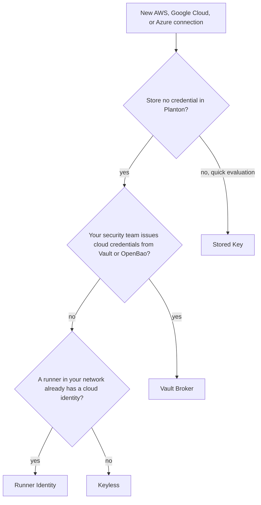

# Cloud Providers

To deploy infrastructure through Planton, the platform needs permission to act in your cloud accounts. Cloud provider connections give Planton that permission — to create, update, and manage resources from VPCs and Kubernetes clusters to databases and DNS zones — scoped to the environments you authorize. Depending on the method you choose, a connection holds an encrypted credential, or holds no credential at all.

## One Journey on Every Cloud

Every AWS, Google Cloud, and Azure connection takes the same path through the wizard:

1. **Name** the connection.
2. **Connection Method**: choose how Planton gets in (below).
3. **Where it deploys**: the **Account** on AWS, the **Project** on Google Cloud, the **Subscription** on Azure.
4. **Permissions**: what Planton may deploy (see [What Planton May Deploy](#what-planton-may-deploy)).
5. **How Planton gets in**: **Set Up** for a keyless connection, **Credentials** for a stored key, **Runner** for a runner's identity, **Vault Broker** for a broker.
6. **Review & Create**.

The screen after **Create** runs the connection's first Verify and says what it can deploy (see [What Verify Tells You](#what-verify-tells-you)).

## Choosing an Authentication Method

The connection wizard lists the methods your Planton instance offers; on planton.ai, **Keyless** is listed first and recommended. The four methods have the same names on every cloud: **Keyless**, **Stored Key**, **Runner Identity**, and **Vault Broker**.

### Keyless

Your account trusts Planton's identity issuer directly. For each operation, Planton signs a short-lived token for this one connection, and your cloud exchanges it for short-lived credentials: an IAM role on AWS, a service account through Workload Identity Federation on Google Cloud, or an app registration through a federated identity credential on Azure. Planton stores no access key, key file, or client secret, so there is nothing to leak or rotate.

You build the trust once, in your own account, before the connection exists: with a setup script the console fills in for you, or, on Google Cloud and Azure, with **Set It Up for Me**, one consent after which Planton builds the trust and discards its access. The wizard then asks your cloud whether it trusts the connection (**Check the Trust**), and the connection is created on the next step, once it does. See [Keyless Cloud Connections](/docs/connections/keyless-cloud-connections) for the setup on each cloud, and [What Your Cloud Trusts](/docs/security/what-your-cloud-trusts) for exactly what the trust admits.

**When to use**: Production accounts, and any account where you want no stored credential and trust you can read and revoke in your own cloud.

### Stored Key

Provide an access key, a service account key, or a service principal's client secret. The connection references them as encrypted secrets in your organization, and Planton supplies them to each deployment.

**When to use**: Quick evaluation, development accounts, or when you cannot create an identity provider or federated credential in the account.

**Trade-off**: The credential is long-lived and stored (encrypted) in Planton. You rotate it yourself.

### Runner Identity

Deploy a [Planton Runner](/docs/runner) in your own infrastructure and let it authenticate with the identity its environment already provides — the AWS SDK credential chain (IRSA, an instance profile, an ECS task role), GCP Application Default Credentials (Workload Identity), or the Azure credential chain (Managed Identity). No credential is stored in Planton; deployments for the connection run on that runner.

**When to use**: Teams that already run a runner with a cloud identity and require credentials to stay inside their network.

**Trade-off**: You deploy and maintain the runner. See the [Runner documentation](/docs/runner) for deployment options.

### Vault Broker

Your HashiCorp Vault or OpenBao issues short-lived cloud credentials at deploy time through its AWS, GCP, or Azure secrets engine. The connection stores no cloud credential: it names a Vault connection in your organization and the secrets-engine role to read. The runner logs in to your Vault, reads credentials for one job, and revokes its Vault session when the job ends. Optionally pick the runner that can reach your Vault over the network.

**When to use**: Organizations whose security team issues cloud credentials through a broker.

---

## What Planton May Deploy

Every cloud connection, whatever its method, asks what Planton may deploy through it. The wizard's **Permissions** step offers two answers:

- **Everything Planton Can Deploy** (recommended) — every kind in Planton's catalog for that cloud, and what Planton itself uses the connection for.
- **Only What I Pick** — the kinds you tick, shelved by the cloud's own service groups, beside **Used by Planton Itself** (the pickers that list your projects and networks, and Verify, are always included; a state backend, a secret backend, a container registry or Kubernetes access you tick when the connection serves one). Deploying anything else waits for an update to the grant.

Two kinds of access stay off unless you turn them on, and each says how many kinds need it: **Organization Access** (what sits above the connection's target: AWS Organizations, Google Cloud folders, the organization and billing accounts, Azure management groups) and **Access Granting** (giving people and identities access across the account, project or subscription: roles, policies and keys). Access to what a kind deploys is always included.

The permissions come from the catalog: each kind declares exactly what it needs, and the connection's identity holds exactly the permissions of what you chose, never a broad role like AdministratorAccess, Owner, Editor or Contributor. **Show the Role** (**Show the Policies** on AWS, **Show the Token Recipe** on DigitalOcean and Cloudflare) shows exactly what will be applied.

- A **Keyless** setup applies it for you: it creates the connection's own role (`planton_<org>_<connection>` on Google Cloud, `Planton Deployer (<org>/<connection>)` on Azure) or its own IAM role and policies on AWS (`planton-<org>-<connection>`, with policies `planton-<org>-<connection>-1`, `-2` and so on).
- For a **Stored Key**, **Runner Identity** or **Vault Broker** connection, you grant the same role or policies to the identity yourself: the service account whose key you upload, the IAM user whose keys the connection holds, the runner's own identity, or the identity your Vault issues credentials for.

When the catalog adds a kind or needs more, the connection's page offers **Update the Grant**.

---

## What Verify Tells You

Every cloud connection's page has **Verify**, and the screen after **Create** runs it once on its own. It signs in through exactly the path a deploy uses, then asks your cloud what that identity is allowed to do. The answer is what Planton can deploy with the connection, counted against what you let it deploy, the connection's grant: **"171 of 186 GCP Kinds Can Deploy"**. A connection limited to the kinds you picked reads, for example, **All 12 Granted GCP Kinds Can Deploy**.

<!-- SCREENSHOT: Google Cloud connection - Verify's deployability answer
  Page: /orgs/{org}/connections/gcp/{connection} (Verify panel)
  Action: Click Verify on a keyless GCP connection whose role is missing part of its grant (for example, a permission removed from the connection's role in the Google Cloud console), then open Can't Deploy Yet
  Focus: The "N of M GCP Kinds Can Deploy" headline, the "The Cloud Is Missing Part of This Grant" notice with Apply the Grant Again and Copy Permissions for gcloud, and one blocked kind with its missing permissions
  Alt: GCP connection Verify panel showing how many catalog kinds the connection can deploy, the way to apply the grant again, and a blocked kind's missing permissions
-->

- **Can't Deploy Yet** lists the kinds the connection's grant covers that its identity can't deploy yet, each with exactly the permissions it's missing. A newer catalog may need more than the identity holds, or someone removed a permission in your cloud. Above the list, one sentence says what is missing (on Google Cloud and Azure, from the connection's Planton Deployer role; on AWS, from the role's policies), and **Apply the Grant Again** gives your cloud the whole grant once more. The missing access is one click away in the form your cloud's own tool takes it, for example **Copy Permissions for gcloud**.
- **Can Deploy** lists every kind the identity can deploy. When some of these kinds' permissions were read from their modules' source and not yet proven in a live run, a note says so.
- **Not in This Connection's Grant** lists what you chose to leave out. It never counts against the connection; **Add These Kinds** opens the grant with them ticked.

When something Planton itself needs from the connection is missing (the pickers that list your projects and networks, a secret or state backend), Verify lists it apart, under **Planton's Own Uses That Can't Work Yet**, with what it lacks.

What each cloud is asked:

| Cloud | How Planton checks | What lets it check |
|---|---|---|
| Google Cloud | Google's permission check on the connection's project | Nothing extra; the Cloud Resource Manager API must be on (a keyless setup turns it on) |
| AWS | The IAM policy simulator, for the connection's role or user | `iam:SimulatePrincipalPolicy` on that role or user (every grant includes it) |
| Azure | The permissions your roles grant at the subscription | Nothing extra |
| Cloudflare | The token's own permission groups | **API Tokens Read** on the token |
| DigitalOcean | Not checked: DigitalOcean shows a token's scopes only in its control panel | — |

When Verify can't reach an answer, it says why in one line, for example a runner built before this check that needs upgrading. It never claims a connection can deploy nothing.

### When Your Cloud Says No

When your cloud refuses a step, the sentence says what happened and what to do. **Show GCP's Reason** (or AWS's, or Azure's) opens your cloud's own words: its error code, the API it named, and its message, so you can check Planton's reading or hand it to whoever runs the account. When the cloud names a page that fixes it, for example an API that's turned off, that page is one button away: **Turn On Cloud Resource Manager API**.

---

## AWS

AWS connections support Keyless, Stored Key (an access key pair), Runner Identity, and Vault Broker.

### Connecting via the Web Console

1. Navigate to **Connections** and click the **AWS** card under Infrastructure.
2. **Name your connection** — choose a descriptive name like "AWS Production" or "aws-dev-sandbox". The slug is derived from the name ("AWS Production" becomes `aws-production`), because a slug is lowercase letters and digits joined by single hyphens, like my-app-2.
3. **Choose your authentication method**:
   - **Keyless** — Enter your account ID and region, choose what Planton may deploy, then run the AWS CLI script the console gives you, or upload the same template in the CloudFormation console. The script registers Planton's identity issuer in your account and creates a role only this connection can assume; the connection is created once AWS confirms the role trusts it. See [Keyless Cloud Connections](/docs/connections/keyless-cloud-connections#aws).
   - **Stored Key** — Identify the account and region, choose what Planton may deploy and attach the policies the Permissions step shows to the IAM user, then select the secrets that hold your Access Key ID and Secret Access Key (and a session token, for temporary credentials).
   - **Runner Identity** — Identify the account and region, choose what Planton may deploy, then select an existing runner or create a new one. The runner authenticates with its own AWS identity.
   - **Vault Broker** — Identify the account, choose what Planton may deploy, then point the connection at the Vault connection and secrets-engine role that issue its credentials.
4. **Review & Create** — click **Create**.

<!-- SCREENSHOT: AWS connection wizard - auth method selection
  Page: /orgs/{org}/connections (AWS connect wizard, Connection Method step)
  Action: Show the method step with the four method rows visible
  Focus: The Keyless (Recommended), Stored Key, Runner Identity, and Vault Broker rows
  Alt: AWS connection wizard showing Keyless, Stored Key, Runner Identity, and Vault Broker options
-->

### What You Need

| Field | Description |
|-------|-------------|
| Account ID | Your 12-digit AWS account number |
| Region | The connection's default region (every method) |
| Access Key ID | A secret holding the 20-character key starting with AKIA (Stored Key only) |
| Secret Access Key | A secret holding the 40-character secret (Stored Key only) |

For Keyless, the setup script creates the IAM role and its policies, so you supply no key. For Runner Identity, you need a runner deployed with an identity that holds the policies the Permissions step shows.

---

## Google Cloud Platform

GCP connections support Keyless, Stored Key (a service account key), Runner Identity, and Vault Broker.

### Connecting via the Web Console

1. Navigate to **Connections** and click the **GCP** card under Infrastructure.
2. **Name your connection** and choose an authentication method:
   - **Keyless** — Enter your project ID and choose what Planton may deploy, then build the trust by clicking **Set It Up for Me** or by running the `gcloud` script the console gives you; the connection is created once Google confirms the trust. See [Keyless Cloud Connections](/docs/connections/keyless-cloud-connections#google-cloud).
   - **Stored Key** — Choose what Planton may deploy, grant the role the Permissions step shows to the service account, then reference a secret holding the service account's JSON key.
   - **Runner Identity** or **Vault Broker** — as described in [Choosing an Authentication Method](#choosing-an-authentication-method).
3. **Review & Create** — click **Create**.

<!-- SCREENSHOT: GCP connection wizard - auth method selection
  Page: /orgs/{org}/connections (GCP connect wizard, Connection Method step)
  Action: Show the method step with all method rows visible
  Focus: The Keyless (Recommended), Stored Key, Runner Identity, and Vault Broker rows
  Alt: GCP connection wizard showing Keyless, Stored Key, Runner Identity, and Vault Broker options
-->

### What You Need

| Method | What you provide |
|--------|-----------------|
| Keyless | The project ID, and a service account email (the setup creates the service account if it doesn't exist) |
| Stored Key | A secret holding the service account's JSON key, raw or base64-encoded |

### Preparing a Service Account Key

For the Stored Key method, in the Google Cloud Console:

1. Create a service account in the project where Planton will manage resources.
2. On the wizard's **Permissions** step, choose what Planton may deploy and click **Show the Role**: create that custom role in the project and grant it to the service account.
3. Create a JSON key for the service account.
4. Store the key's contents as a secret in your organization, raw or base64-encoded, and select that secret in the wizard.

---

## Microsoft Azure

Azure connections support Keyless, Stored Key (a service principal secret), Runner Identity, and Vault Broker. Every method needs your subscription ID.

### Connecting via the Web Console

1. Navigate to **Connections** and click the **Azure** card under Infrastructure.
2. **Name your connection** and choose an authentication method:
   - **Keyless** — Enter the subscription ID and choose what Planton may deploy, then build the trust by clicking **Set It Up for Me** (one Microsoft consent) or by running the `az` scripts the console gives you and pasting back the tenant ID and client ID they print; the connection is created once Microsoft confirms the trust. No client secret exists. See [Keyless Cloud Connections](/docs/connections/keyless-cloud-connections#azure).
   - **Stored Key** — Enter the tenant ID, the subscription ID and the app registration's client ID, and select the secret that holds its client secret.
   - **Runner Identity** or **Vault Broker** — as described in [Choosing an Authentication Method](#choosing-an-authentication-method).
3. **Review & Create** — click **Create**.

<!-- SCREENSHOT: Azure connection wizard - auth method selection
  Page: /orgs/{org}/connections (Azure connect wizard, Connection Method step)
  Action: Show the method step with all method rows visible
  Focus: The Keyless (Recommended), Stored Key, Runner Identity, and Vault Broker rows
  Alt: Azure connection wizard showing Keyless, Stored Key, Runner Identity, and Vault Broker options
-->

### What You Need

| Field | Description |
|-------|-------------|
| Tenant ID | Your Microsoft Entra ID tenant identifier (Keyless: the setup reads or prints it) |
| Subscription ID | The Azure subscription where resources will be managed (every method) |
| Client ID | The application (client) ID of your app registration (Keyless: the setup creates or adopts the app and records it; Stored Key: you enter it, or name an organization variable that holds it) |
| Client Secret | The client secret value, stored as a secret (Stored Key only) |

### Preparing a Service Principal

For the Stored Key method, in the Azure Portal:

1. Register an application in Microsoft Entra ID.
2. Create a client secret for the application.
3. On the wizard's **Permissions** step, choose what Planton may deploy and click **Show the Role**: create that role definition and assign it to the application on the subscription.

For Keyless, skip the client secret: the console creates the app registration for you or gives you a script that does, and the trust is a federated identity credential.

---

## DigitalOcean

DigitalOcean connections use an API token to authenticate. Optionally, you can provide Spaces credentials for object storage operations.

### What You Need

| Field | Description |
|-------|-------------|
| API Token | A personal access token from the DigitalOcean control panel |
| Default Region | The region for new resources (required) |
| Spaces Access ID | Access key for DigitalOcean Spaces (optional, for object storage) |
| Spaces Secret Key | Secret key for DigitalOcean Spaces (optional) |

Generate an API token from the DigitalOcean control panel under **API > Tokens/Keys**. For Spaces, create a separate Spaces access key under **API > Spaces Keys**.

---

## Cloudflare

Cloudflare connections support two authentication schemes. The recommended approach uses a scoped API token; the legacy approach uses a global API key with your account email.

### What You Need (Recommended)

| Field | Description |
|-------|-------------|
| API Token | A scoped API token created in the Cloudflare dashboard |

### What You Need (Legacy)

| Field | Description |
|-------|-------------|
| API Key | Your global API key from the Cloudflare dashboard |
| Email | The email address associated with your Cloudflare account |

### R2 Storage Credentials

If you deploy a Cloudflare Worker whose code is a pre-built bundle stored in R2 (the Worker's `r2Bundle` source), the connection also needs an R2 key pair. Planton reads the bundle through R2's S3-compatible API, which the API token cannot sign for. A Worker that is only bound to an R2 bucket needs no R2 keys.

| Field | Description |
|-------|-------------|
| R2 Access Key ID | Access key of an R2 API token with Object Read on the bundle bucket (minimum 20 characters) |
| R2 Secret Access Key | Secret key paired with the access key (minimum 20 characters) |
| R2 Endpoint | Custom endpoint URL (optional; defaults to `https://<account_id>.r2.cloudflarestorage.com`) |

Create an R2 key pair in the Cloudflare dashboard under **R2 > Manage R2 API Tokens**.

Create API tokens in the Cloudflare dashboard under **My Profile > API Tokens**. Use the **Create Token** button to create a scoped token with only the permissions your deployments need.

---

## Common Patterns

### One Connection Per Account

Create separate connections for each cloud account. A "production AWS account" and a "development AWS account" should be two distinct connections, even if they belong to the same organization. This makes it straightforward to authorize the right credential for the right environment.

### Naming Conventions

Use names that identify both the provider and the purpose:

- `aws-production` — clear and specific
- `gcp-analytics-project` — identifies the GCP project's role
- `azure-staging` — identifies the environment intent

Avoid generic names like `aws1` or `my-cloud` — they become confusing as the number of connections grows.

### Credential Rotation

Keyless connections need no rotation: Planton stores no credential for them, each token it signs is valid for 15 minutes, and your cloud trusts the issuer's published keys, which Planton rotates without any change on your side. Runner Identity and Vault Broker connections store nothing to rotate either; the runner's environment or your Vault issues the credentials.

To rotate a stored key, update the secret the connection references, or point the connection at a new secret. Planton uses the new values for operations that start after the change.

## Related Documentation

- [Keyless Cloud Connections](/docs/connections/keyless-cloud-connections) — Set up a keyless trust in AWS, Google Cloud, and Azure
- [What Your Cloud Trusts](/docs/security/what-your-cloud-trusts) — The exact values a keyless trust pins, and how to revoke it
- [Connections Overview](/docs/connections) — Understanding the Connect system
- [Environment Mappings](/docs/connections/environment-mappings) — Authorize connections for specific environments
- [Default Connections](/docs/connections/default-connections) — Configure automatic credential selection
- [Runner](/docs/runner) — Deploy a Runner for the Runner Identity method
