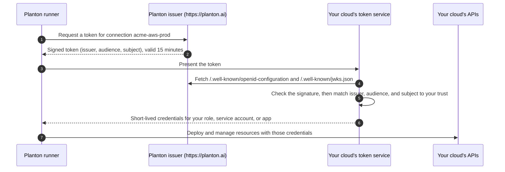

# Keyless Cloud Connections

A keyless connection lets Planton work in your AWS account, Google Cloud project, or Azure subscription without storing a credential for it. For each operation, Planton signs a short-lived token that names exactly one connection. Your cloud checks the token against Planton's published signing keys and against a trust you create once in your own account, then exchanges it for short-lived credentials. In the console this method is called **Keyless**, and on planton.ai it is the first method listed, and the recommended one, for AWS, Google Cloud, and Azure.

## Why Keyless

An access key, a service account key file, or a client secret is a long-lived credential. Whoever holds a copy can use it until someone rotates it, and rotating it means finding every place it was pasted. A keyless connection has no such credential:

- **Nothing to leak.** The connection stores no access key, no key file, and no client secret. It holds only pointers: the role ARN on AWS, the workload identity provider and service account on Google Cloud, and the app registration's tenant, subscription, and client ID on Azure.
- **Nothing to rotate.** Each token Planton signs is valid for 15 minutes, and the credentials your cloud exchanges it for are short-lived too.
- **The trust lives in your account.** You decide what Planton may deploy, the connection's own role holds exactly that, and you can read every line of the setup before it runs. Deleting that trust in your cloud ends Planton's access, with no key to revoke.
- **One trust per connection.** The trust pins the connection's exact subject, so a token for any other connection, in your organization or anyone else's, is refused.
- **No Planton cloud account is involved.** Your cloud trusts Planton's issuer URL, `https://planton.ai`. No Planton-owned AWS account, Google project, or Azure tenant appears in your trust, and no shared secret such as an external ID exists.

## How It Works



Every token carries three values, and your cloud's trust pins all three:

| Value | What it is | Example |
|-------|-----------|---------|
| Issuer | Who signed the token | `https://planton.ai` |
| Audience | Which token service the token is for | `sts.amazonaws.com` on AWS, `api://AzureADTokenExchange` on Azure, and the workload identity provider's full resource name on Google Cloud |
| Subject | Exactly one connection | `planton:v1:org:acme:conn:acme-aws-prod:provider:aws` |

The subject always has the form `planton:v1:org:<organization slug>:conn:<connection slug>:provider:<aws|gcp|azure>`. The signing keys are not pinned: your cloud reads them from Planton's published key set, so Planton can rotate them without any change on your side. [What Your Cloud Trusts](/docs/security/what-your-cloud-trusts) describes these values, and how to inspect them, in detail.

What you create in each cloud:

| Cloud | What trusts Planton's issuer | What Planton acts as |
|-------|------------------------------|----------------------|
| AWS | An IAM OIDC identity provider for `planton.ai`, one per account, shared by every Planton connection in it | The connection's own IAM role, `planton-<organization>-<connection>`, whose trust policy accepts only this connection's subject, with the policies of what you chose to deploy |
| Google Cloud | A workload identity pool (`planton` by default), shared by every Planton connection in the project, holding one OIDC provider per connection | A service account that only this connection's subject may impersonate, holding the connection's own custom role, `planton_<organization>_<connection>` |
| Azure | A federated identity credential on an app registration, one per connection | The app registration's service principal, assigned the connection's own role on your subscription, `Planton Deployer (<organization>/<connection>)` |

## Setting Up a Keyless Connection

The journey is the same on every cloud, and the connection is created last, once your cloud trusts it:

1. **Name the connection and choose Keyless.** The connection's subject is built from your organization and the connection's name, so the trust can pin it before the connection exists.
2. **Say where it deploys**: the account, project, or subscription.
3. **Permissions**: choose what Planton may deploy. The setup gives the connection's own role exactly those permissions (see [What Planton May Deploy](/docs/connections/cloud-providers#what-planton-may-deploy)).
4. **Set Up**: build the trust in your cloud, with the setup script the console fills in, or, on Google Cloud and Azure, with **Set It Up for Me**, one consent after which Planton builds it for you and discards its access. Every way ends in **Check the Trust**: Planton asks your cloud itself whether it now trusts the connection, and waits while the cloud spreads a new trust. **Next** opens once it does.
5. **Review & Create**: click **Create**. The screen after it runs the connection's first Verify and says what it can deploy.

The setups on this page are described for an example connection: organization `acme`, connections `acme-aws-prod`, `acme-gcp-prod`, and `acme-azure-prod`, AWS account `123456789012`, Google Cloud project `acme-prod`, and placeholder Azure IDs, each with **Everything Planton Can Deploy**. Copy your script from the console, not from this page. Your subject, account, names, and permissions differ, and your cloud matches the trust's values as exact strings. Each script prints every step as it starts (`Step 1 of 3: …`), in the same words the console shows beside it.

## AWS

### What You Need

- Your 12-digit AWS account ID and a region.
- A shell with the AWS CLI signed in to that account, with permission to manage IAM OIDC identity providers, roles, and managed policies. The console notes that AWS CloudShell works. The script also uses `openssl` when it registers the identity provider for the first time. Or, instead of the script, permission to create a CloudFormation stack that creates the same.

### Steps in the Console

1. Open **Connections** and click the **AWS** card under Infrastructure.
2. **Name** the connection, for example `acme-aws-prod`. The role's name is derived from it and your organization: `planton-acme-acme-aws-prod`.
3. Choose **Keyless**.
4. **Account**: enter the **AWS Account ID** and the **Default Region**.
5. **Permissions**: choose what Planton may deploy. **Everything Planton Can Deploy** (recommended) covers every AWS kind in Planton's catalog and what Planton itself uses the connection for; **Only What I Pick** shelves the kinds by AWS's own service groups for you to tick. **Organization Access** (AWS Organizations: its accounts and organizational units) and **Access Granting** (IAM users, roles, policies and keys across the account) stay off unless you turn them on; each says how many kinds need it. **Show the Policies** shows exactly what the role will hold.
6. **Set Up**: build the role in your account in one of two ways:
   - **Run the Setup Script** the step shows, with the AWS CLI signed in to that account.
   - **Prefer CloudFormation? Show the Template**: download the template, then in the CloudFormation console choose **Create stack**, **Upload a template file**. It creates exactly what the script does; run one of the two.

   Then click **Check the Trust**. Planton asks AWS whether the role trusts this connection; AWS takes a few seconds to accept a new role and its identity provider, and the step waits for it. Once AWS says yes, **Next** opens. If you need to hand the setup to someone who administers the account, **Create It Now, Finish the Trust Later** creates the connection, and its page keeps the same setup and its check until the trust works.
7. **Review & Create**: click **Create**. The connection is created with the role the trust admits, and the next screen runs its first Verify and says what it can deploy.

<!-- SCREENSHOT: AWS keyless setup - the Set Up step
  Page: /orgs/{org}/connections (AWS connect wizard, Set Up step)
  Action: Choose Keyless, enter the account ID and region, keep Everything Planton Can Deploy, open the Set Up step
  Focus: The "Set Up With the Script" notice, the Run the Setup Script block with its copy button, Prefer CloudFormation? Show the Template, Check the Trust in the footer, and Create It Now, Finish the Trust Later
  Alt: AWS keyless connection wizard showing the setup script, the CloudFormation template option, and the Check the Trust button
-->

### What the Script Does

For `acme-aws-prod` with **Everything Planton Can Deploy**, the script runs three steps:

1. **Registers `planton.ai` as an identity provider in account `123456789012`**, which every Planton connection in the account shares, or keeps it when it exists (adding the `sts.amazonaws.com` audience when it lacks it). AWS allows one provider per issuer URL in an account. The script never deletes it.
2. **Creates this connection's own role `planton-acme-acme-aws-prod`**, which only the tokens `planton.ai` signs for this connection can assume, or rewrites its trust policy to that when it exists. The trust policy accepts a token only when `planton.ai:aud` is `sts.amazonaws.com` and `planton.ai:sub` is this connection's subject. Sessions last at most one hour.
3. **Writes the policies rendered from this connection's grant onto the role**, replacing the ones a previous grant put there: the managed policies `planton-acme-acme-aws-prod-1`, `-2` and so on, and an inline policy when they need one, rendered from your choice and Planton's catalog. An existing policy gets a new default version (the oldest kept version is removed when AWS's five are in use), and any of the connection's own policies a narrower choice no longer needs is detached and deleted, so the role holds exactly what you chose.

It ends by printing the role's ARN, `arn:aws:iam::123456789012:role/planton-acme-acme-aws-prod`.

### Running It Again, and a Second Connection

Running the script again ends in the same state: it adopts the identity provider, rewrites the role's trust policy, and writes each policy to exactly your current choice. Run it again after a failed check, or after reviewing a change.

A second connection in the same account, for example `acme-aws-staging`, gets its own script. That script adopts the identity provider the first one registered and creates a second role, `planton-acme-acme-aws-staging`, whose trust policy pins the second connection's subject. Neither role accepts the other connection's tokens.

## Google Cloud

### What You Need

- Your project's ID, for example `acme-prod`. Planton looks up the project number itself.
- For **Set It Up for Me**, a Google account that administers the project (Role Administrator, Project IAM Admin, Workload Identity Pool Admin and Service Account Admin, or Owner). Planton checks that the account may make every change before it changes anything. With Organization Access, the organization's Organization Role Administrator and Organization Administrator roles too.
- For the script, a shell with `gcloud` signed in with the same permissions in the project (Cloud Shell works).

### Steps in the Console

1. Open **Connections** and click the **GCP** card under Infrastructure.
2. **Name** the connection, for example `acme-gcp-prod`.
3. Choose **Keyless**.
4. **Project**: enter the **Project ID** (`acme-prod`). The console suggests the **Service Account** `planton-provisioner@acme-prod.iam.gserviceaccount.com`, which the setup creates if it does not exist; you can name an existing one instead. If you already run a workload identity pool, click **Already have a Workload Identity provider?** and paste its full resource name.
5. **Permissions**: choose what Planton may deploy, as on AWS: **Everything Planton Can Deploy** (recommended) or **Only What I Pick**, with **Organization Access** (folders, the organization and billing accounts) and **Access Granting** off unless you turn them on. **Show the Role** shows the custom role the setup creates.
6. **Set Up**: build the trust in your project in one of two ways:
   - **Set It Up for Me**: sign in with a Google account that administers the project. Planton uses the one-time consent to turn on the APIs the trust and Planton need, create the pool, the provider, the service account and the binding, and create this connection's own custom role and grant it to the service account, then discards the token. No refresh token is minted and nothing about your Google access is stored.
   - **Prefer to Run It Yourself? Show the Setup Script**: run the script, then paste the line it prints into **The Line the Script Printed** and click **Check the Trust**.

   Either way, Planton then asks Google whether it trusts this connection. A new provider can take a minute or two to spread inside Google, and the step waits for it. If a GCP connection with the same name already exists, the step says so before anything is built and offers **Change the Name**.
7. **Review & Create**: click **Create**. The connection is created with the provider the trust admits, and the next screen runs its first Verify and says what it can deploy.

<!-- SCREENSHOT: Google Cloud keyless setup - the Set Up step
  Page: /orgs/{org}/connections (GCP connect wizard, Set Up step)
  Action: Choose Keyless, enter the project ID, keep Everything Planton Can Deploy, open Prefer to Run It Yourself? Show the Setup Script
  Focus: What the setup builds (APIs Turned On, Identity Pool, Provider, Service Account, Roles), the expanded gcloud script, and The Line the Script Printed field
  Alt: Google Cloud keyless connection wizard showing what the setup builds, the gcloud setup script, and its paste-back field
-->

### What the Script Does

For `acme-gcp-prod` in project `acme-prod` with **Everything Planton Can Deploy**, the script runs six steps:

1. **Turns on the Google APIs the trust and Planton need in project `acme-prod`**: IAM, IAM Service Account Credentials, Security Token Service, Cloud Resource Manager and Service Usage. An API already on is left as it is. Every other API is turned on by the kind that needs it, when it first deploys. With Organization Access, the APIs the organization's and billing account's kinds call are turned on here too.
2. **Creates the Workload Identity Pool `planton`**, which every Planton connection in the project shares, or keeps it when it exists. If it exists in any other state (for example, deleted), the script stops and says so.
3. **Creates this connection's own OIDC provider `planton-acme-gcp-prod`** in that pool, accepting only the tokens `https://planton.ai` signs for this connection, or keeps it when it already trusts exactly that.
4. **Creates the service account** `planton-provisioner@acme-prod.iam.gserviceaccount.com`, or keeps it when it exists. If you named a service account whose email is not in the standard `<name>@<project-id>.iam.gserviceaccount.com` form, the script uses your existing account and creates nothing for it.
5. **Lets this connection act as the service account**: the role `roles/iam.workloadIdentityUser` on that account, for this connection's identity only.
6. **Writes this connection's own role `planton_acme_acme_gcp_prod`** in the project from this connection's grant, holding exactly the permissions of what you chose, and grants it to the service account, with the few predefined roles Google keeps permissions in that a custom role cannot hold beside it. Run again after you change your choice, it updates the role to the new set. With Organization Access, the same role is created in the project's organization, and the billing roles are granted on the project's billing account.

It ends by printing the provider's full name, the line you paste back into the console.

### Running It Again, and a Second Connection

Running the script again ends in the same state: the APIs, the pool, the provider and the service account are kept when they already match, adding an IAM binding that already exists changes nothing, and the role is written to exactly your current choice.

A second connection in the same project, for example `acme-gcp-staging`, reuses the `planton` pool and gets its own provider, `planton-acme-gcp-staging`, and its own role, both named by Planton from the connection's name. If a provider with that name already exists and trusts a different issuer or subject, or was deleted, the script stops instead of changing it.

Google limits provider IDs to 32 characters. For a long connection name, Planton shortens the provider ID and appends a short hash of the name, so two long names still get two different providers.

## Azure

### What You Need

- Your subscription ID. The tenant comes from the account that sets it up.
- For **Set It Up for Me**, a Microsoft account that can grant admin consent in your Entra tenant and holds Owner (or User Access Administrator) on the subscription.
- For the scripts, a shell with `az` signed in to your tenant, with permission to create app registrations, role definitions and role assignments on the subscription. The console suggests Cloud Shell.

### Steps in the Console

1. Open **Connections** and click the **Azure** card under Infrastructure.
2. **Name** the connection, for example `acme-azure-prod`.
3. Choose **Keyless**.
4. **Subscription**: enter the **Subscription ID**. **App Registration** names the app Planton signs in as, `planton-provisioner` by default; the setup creates it, or adopts it when it exists. Keep the default unless you bring your own app.
5. **Permissions**: choose what Planton may deploy, as on AWS. **Show the Role** shows the role definition the setup creates.
6. **Set Up**: build the trust in one of two ways:
   - **Set It Up for Me**: one Microsoft consent. Planton creates or adopts the app registration, its service principal, the federated credential that trusts exactly this connection, and this connection's own role and its assignment on the subscription, then discards its access. No refresh token is ever issued, and no client secret exists.
   - **Prefer to Run It Yourself? Show the Setup Scripts**: run both scripts below, then paste the **Tenant ID** and **Client ID** they print and click **Check the Trust**.

   Either way, Planton then asks Azure whether it trusts this connection. A new federated credential and role take a minute or two to spread, and the step waits for it. If an Azure connection with the same name already exists, the step says so before anything is built and offers **Change the Name**.
7. **Review & Create**: click **Create**. The next screen runs the connection's first Verify and says what it can deploy.

<!-- SCREENSHOT: Azure keyless setup - the Set Up step
  Page: /orgs/{org}/connections (Azure connect wizard, Set Up step)
  Action: Choose Keyless, enter the subscription ID, keep Everything Planton Can Deploy, open Prefer to Run It Yourself? Show the Setup Scripts
  Focus: Set It Up for Me in the footer with the sentence above it, the two script tabs (1. Set Up the App and Role, 2. Trust This Connection), and the Tenant ID and Client ID fields
  Alt: Azure keyless connection wizard showing the one-consent setup, the two setup scripts, and the tenant and client ID fields
-->

### What the Scripts Do

The first script, **Set Up the App and Role**, runs four steps:

1. **Creates the app registration `planton-provisioner`**, the identity this connection signs in as, or keeps it when it exists.
2. **Creates the app's service principal**, which the role is assigned to, or keeps it when it exists.
3. **Writes this connection's own role `Planton Deployer (acme/acme-azure-prod)`** in the subscription from this connection's grant, holding exactly the actions of what you chose, never Contributor. It also holds the right to register the resource providers your kinds use: Planton registers each one when a kind that needs it first deploys.
4. **Assigns that role to the app's service principal** across the subscription.

It ends by printing the tenant ID and client ID to paste into the console. No secret is created; keyless connections never need one.

The second script, **Trust This Connection**, adds the federated credential `planton-conn-acme-azure-prod` to the app registration `planton-provisioner`, accepting only the tokens `https://planton.ai` signs for this connection, or keeps it when it already does. Microsoft Entra matches the issuer, the subject and the audience `api://AzureADTokenExchange` as exact strings.

### Running It Again, and a Second Connection

The first script reuses an app registration and service principal that already exist, and writes the role to exactly your current choice. The second script names the credential after the connection, `planton-conn-<connection slug>`. Running it again keeps a credential that already trusts this connection. If a credential with that name pins a different issuer or subject, the script stops and asks you to remove or rename it, rather than taking that trust away from whatever it belongs to.

A second connection, for example `acme-azure-staging`, can use the same app registration: keep the same **App Registration** name, and its scripts add `planton-conn-acme-azure-staging` beside the first credential and give it its own role, `Planton Deployer (acme/acme-azure-staging)`.

## Details

### Check What the Script Created

Each cloud's own CLI shows the trust exactly as your cloud will evaluate it:

```bash
# AWS: the role's trust policy (issuer host, audience, and subject)
aws iam get-role --role-name planton-acme-acme-aws-prod --query Role.AssumeRolePolicyDocument

# Google Cloud: the provider's issuer, allowed audience, and attribute condition
gcloud iam workload-identity-pools providers describe planton-acme-gcp-prod \
  --project=acme-prod --location=global --workload-identity-pool=planton

# Azure: the app registration's federated credentials
az ad app federated-credential list --id "$(az ad app list --display-name planton-provisioner --query '[0].id' --output tsv)"
```

### When the Check Fails

**Check the Trust** shows what your cloud answered, and **Show AWS's Reason** (or GCP's, or Azure's) opens your cloud's own words. Compare the subject and issuer with your cloud's trust; a single different character is enough to fail.

| Cloud | What you see | Most likely cause |
|-------|-------------|-------------------|
| AWS | AWS refused the role | The script or stack has not finished yet, or the role's trust policy names a different subject or issuer host |
| Google Cloud | Google denied service-account impersonation | The `roles/iam.workloadIdentityUser` binding is still spreading (the step keeps asking), or it names a different subject |
| Google Cloud | The audience does not match, or the issuer is not trusted | The provider trusts a different issuer, or the line pasted back names a different provider |
| Azure | `AADSTS70021` (no matching federated identity record) | The credential is still spreading (the step keeps asking), or its issuer, subject, or audience differs |

Run the script again after you fix the cause. Every script is safe to rerun.

### Self-Hosted Planton

A self-hosted Planton instance signs tokens as its own issuer, its own public address, instead of `https://planton.ai`, and puts it in the script. Keyless connections need the issuer to be reachable from the public internet; where it is not, the console shows the method as unavailable and says why.

### Removing Access

To end a keyless connection's access, delete its trust in your cloud: the IAM role on AWS, the OIDC provider (or the service account binding) on Google Cloud, or the federated identity credential on Azure. Your cloud then refuses Planton's tokens for that connection. Deleting the connection in Planton also stops Planton from signing tokens for it, and its delete dialog lists **What Stays in Your Cloud** with a script that removes exactly that. On AWS, leave the identity provider in place while other Planton connections in the account still use it.

On Google Cloud and AWS you can also delete the connection's own role and policies (`planton_<org>_<slug>`; `planton-<org>-<slug>` and its `-1..N` policies); on Azure, its role assignment and role definition.

## Related Documentation

- [Cloud Providers](/docs/connections/cloud-providers) — Every authentication method for AWS, Google Cloud, Azure, DigitalOcean, and Cloudflare, and what Planton may deploy
- [What Your Cloud Trusts](/docs/security/what-your-cloud-trusts) — The three pinned values, Planton's published keys, and how to revoke
- [Environment Mappings](/docs/connections/environment-mappings) — Authorize a connection for specific environments
- [Default Connections](/docs/connections/default-connections) — Configure automatic credential selection
- [Runner Security Model](/docs/runner/security-model) — How the runner authenticates to your cloud in each mode
