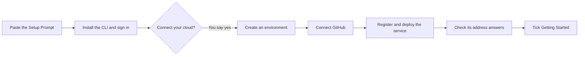

# Getting Started

This guide walks through the first steps on Planton: creating an account and an organization, then connecting your cloud, creating an environment and deploying to it. There are two ways through, and they end in the same place:

- **With your coding agent.** Copy the Setup Prompt from Getting Started and paste it into Claude Code, Codex or Cursor in your app's repository. Your agent does the setup and asks you before anything changes your cloud or costs money.
- **In the console.** Walk the same steps yourself, screen by screen.

By the end, you have a deployment running in your own cloud account.

## Set Up with Your Coding Agent

Create your account and your organization first ([Step 1](#step-1-create-your-account) and [Step 2](#step-2-create-your-organization) below). Your organization's Getting Started page, and Home while setup is unfinished, then lead with **Copy Setup Prompt**.

1. Open your app's repository in Claude Code, Codex or Cursor.
2. In Getting Started, click **Copy Setup Prompt**. The prompt names your organization and your Planton, and carries a sign-in code that works once, within 15 minutes.
3. Paste it into your agent.



What your agent does:

- **Installs the Planton CLI and signs in as you.** It runs the installer, which puts the CLI at `~/.planton/bin/planton`, then `planton login --grant <code>` with the prompt's code. The code becomes a personal API key named for the agent and the machine (for example, "Claude Code on Priyas-MacBook-Pro"). It lasts 30 days and reaches every organization you belong to. You can see and revoke it on your API Keys page (`/user/api-keys`).
- **Reads the playbook and installs the Planton skill.** It fetches [planton.ai/agents.md](https://planton.ai/agents.md), checks the sign-in names you and your organization, and installs the skill for itself, outside your repository.
- **Connects the cloud your machine is signed in to.** It shows you the plan first: what the connection creates in your account and what Planton will be able to deploy. Nothing runs until you say yes. See [Keyless Cloud Connections](/docs/connections/keyless-cloud-connections).
- **Creates an environment, connects GitHub, and deploys your service.** On planton.ai, installing Planton's GitHub App is the one step you take in the browser; the agent sends you there and waits. It asks before anything that costs money.
- **Checks the result and ticks your progress.** It reads the deployment's rollout verdict and address, ticks each Getting Started step it finished with `planton setup done <step>`, and tells you what it set up, with a link to each thing.

Getting Started shows the ticks as they happen. The agent ticks only the steps it finished; you tick the rest yourself.

## Set Up in the Console

The same setup, screen by screen.

## Prerequisites

- A modern web browser
- An AWS, GCP, or Azure account with permissions to create resources
- Either permission to create a keyless trust in that account (see [Keyless Cloud Connections](/docs/connections/keyless-cloud-connections)), or credentials for it (access keys, a service account key, or a service principal)

## Step 1: Create Your Account

Navigate to [planton.ai](https://planton.ai) and click **Login** or **Join Beta** in the header. Both lead to the same authentication page.

The authentication page handles both login and registration. Click **Sign up** to switch to registration mode, then choose one of:

- **Email and password** — enter your email and create a password
- **Continue with Google** — authenticate with your Google account

After completing signup, the console asks you to create your organization.

<!-- SCREENSHOT: Authentication page
  Page: /auth/signup
  Action: Show the signup form with email/password fields and Google option
  Focus: The signup form area
  Alt: Planton signup page showing email and password fields with Continue with Google option
-->

## Step 2: Create Your Organization

An organization is the top-level container for everything in Planton — environments, connections, team members, and billing. It is similar to a Google Cloud organization or an AWS account.

As a new user without an organization, the console prompts you to create one.

1. Click **Create Organization**
2. Enter the organization name (human-readable, e.g., "Acme Corp")
3. Enter the organization slug, e.g., "acme-corp" — this must be unique across the platform. A slug is lowercase letters and digits joined by single hyphens, like my-app-2; an organization's slug also starts with a letter and is 2 to 15 characters
4. Click **Create**

<!-- SCREENSHOT: Create Organization wizard
  Page: /organizations/new/setup
  Action: Show the organization creation form with name and slug fields
  Focus: The form fields
  Alt: Create Organization form with organization name and slug fields
-->

You are now the organization owner. The context selector in the top-left of the header shows your organization name.

## Step 3: Create Your First Environment

Environments are logical groupings that separate your resources — typically corresponding to deployment stages like development, staging, and production. All infrastructure and services deploy into an environment, not directly into an organization.

1. Navigate to **Infra Hub** in the sidebar
2. Click **Create Environment** (or find the environment creation option)
3. Enter a name — start with something like `dev` or `development`
4. Choose where it goes on your **Promotion Paths**, the order pushes deploy your environments in — for your first environment, a new path named after your organization. No trigger-branch push or tag release deploys an environment on no path.
5. Click **Create**

<!-- SCREENSHOT: Create Environment
  Page: /orgs/{org}/environments/create
  Action: Show the environment creation form
  Focus: The environment name field
  Alt: Create Environment form with name field and validation hint
-->

The context selector now shows both your organization and the active environment:

```
Acme Corp / dev
```

**Using the CLI:**

```bash
# Create an environment; at a terminal it asks where it goes on your Promotion Paths
# (for your first one, a new path named after your organization)
planton env create dev --description "Development environment"

# Later ones can say it up front: a new last stage of an existing path
# (--stage <n> joins stage n beside its environments), or on no path
planton env create staging --path acme-corp
planton env create sandbox --no-path

# In a script, a new environment lands on no path; place it afterwards
# (--yes answers the confirm a script cannot)
planton promotion-path set acme-corp --stage dev --yes

# List environments
planton env list

# Set the environment as your default context
planton context set --org acme-corp --env dev
```

## Step 4: Connect a Cloud Provider

Before deploying infrastructure, connect your cloud provider account. This gives Planton the credentials to create and manage resources on your behalf.

1. Click **Connections** in the sidebar
2. Find your cloud provider card (AWS, GCP, Azure, or others) under the **Infrastructure** section
3. Click **Connect** on the provider card
4. Choose how Planton authenticates. For AWS, GCP, and Azure, the wizard lists **Keyless** first: your account trusts Planton's identity issuer, and Planton stores no credential. You say where the connection deploys and what Planton may deploy there, then build the trust in your account with one click (Google Cloud and Azure) or a setup script the wizard fills in; the wizard checks it with your cloud, and the connection is created once the trust works. See [Keyless Cloud Connections](/docs/connections/keyless-cloud-connections) for each cloud's steps. To store a credential instead, choose **Stored Key** and provide:
   - **AWS**: Access Key ID and Secret Access Key
   - **GCP**: A service account key
   - **Azure**: Subscription ID, Tenant ID, Client ID, and Client Secret

   Every method has a **Permissions** step: keep **Everything Planton Can Deploy**, or pick the kinds you use.
5. **Review & Create** — click **Create**. The next screen runs the connection's first Verify and says what it can deploy.
6. Click **Choose Environments and Default**, keep **Authorize for all environments** and **Set as organization default** checked, and click **Complete Setup**.

<!-- SCREENSHOT: AWS connection wizard - Permissions step
  Page: /orgs/{org}/connections (AWS connect wizard, Permissions step)
  Action: Choose Keyless, enter the account ID and region, open the Permissions step
  Focus: Everything Planton Can Deploy (Recommended) and Only What I Pick, the Organization Access and Access Granting switches, and Show the Policies
  Alt: AWS connection wizard Permissions step showing what Planton may deploy and the two kinds of access that stay off unless turned on
-->

The connection now appears in the **Connected Providers** list and is ready for use.

**Why environment authorization matters:** A connection exists at the organization level, but it must be explicitly authorized for each environment where it can be used. This prevents a production AWS account from being accidentally used during development. See [Environment Mappings](/docs/connections/environment-mappings) for details.

## Step 5: Deploy Your First Infra Component

With a cloud provider connected and authorized, you can deploy infrastructure.

1. Open the **Infra Catalog** — click the store icon in the header (right side)
2. Browse or search for a kind (e.g., search "VPC" and filter by your cloud provider)
3. Click the kind to see its details
4. Click **Deploy**
5. Fill in the configuration form with your desired settings
6. Click **Deploy**

<!-- SCREENSHOT: Infra Catalog
  Page: /platform/deployment-store
  Action: Show the kind catalog with provider filter active
  Focus: The kind grid with deploy buttons
  Alt: Infra Catalog showing infrastructure kinds filterable by cloud provider
-->

An Infra Job is created automatically. Infra Jobs are the execution units that run Pulumi, Terraform, or OpenTofu to provision your infrastructure. You can watch the deployment progress in real-time as each operation (init, refresh, plan, apply) completes.

<!-- SCREENSHOT: Infra Job progress
  Page: /orgs/{org}/infra-components/{id} (Infra Jobs tab)
  Action: Show an Infra Job in progress with real-time log output
  Focus: The Infra Job progress panel with operation status
  Alt: Infra Job execution showing real-time progress through init, refresh, plan, and apply stages
-->

Once the Infra Job completes, your Infra Component is live. Navigate to **Infra Hub** in the sidebar and click **Infra Components** to see it listed with its current status.

## Step 6: Follow Getting Started

Your organization's Getting Started page lists the setup steps and ticks each one as it is done, whether you did it in the console or your coding agent did it with `planton setup done`. While setup is unfinished, Home leads with the same Setup Prompt and the next step.

The steps:

| Step | What It Means |
|------|---------------|
| Connect a Cloud Account | A connection to AWS, Google Cloud, Azure or another provider |
| Create an Environment | Somewhere to deploy, such as `dev` |
| Deploy Your First Infra Component | One resource in your cloud |
| Build Your First Chart | Your organization's own Infra Chart, written by your coding agent from one prompt |
| Start a Runner | The secure agent that runs deployments inside your infrastructure |
| Connect a Git Provider | GitHub or GitLab, so services build from your repositories |
| Deploy Your First Service | Your app, built from its repository and running in an environment |
| Invite Team Members | The people you work with |

A self-hosted Planton also lists **Set Up Email Delivery**. Planton Desktop and a console at your organization's own address show the same list without the Setup Prompt. You can dismiss Getting Started at any time.

From a terminal, `planton setup done` with no step lists the steps and which are done. Ticking a step needs the Owner or Infrastructure Admin role in the organization.

## What to Explore Next

With your first resource deployed, here are the natural next steps:

- **Deploy more resources** — return to the Infra Catalog and deploy a database, Kubernetes cluster, or storage bucket. See [Infrastructure](/docs/infrastructure).
- **Deploy an Infra Chart** — instead of individual resources, deploy a coordinated set of resources (e.g., VPC + ECS Cluster + ALB) as a single Infra Chart. See [Infra Charts](/docs/infrastructure/infra-charts).
- **Deploy an application** — connect GitHub, create a Service, and push code to trigger an automated build and deployment pipeline. See [CI/CD](/docs/ci-cd).
- **Invite your team** — go to **Settings > Manage Members** to invite colleagues and assign roles. See [Teams and Access](/docs/teams-and-access).
- **Explore the console** — take a [Platform Tour](/docs/platform/platform-tour) to learn what each section of the console does.

## CLI Quick Reference

These are the CLI commands relevant to the steps in this guide:

```bash
# Set your default context (organization and environment)
planton context set --org <org-slug> --env <env-slug>

# View your current context
planton context get

# List environments
planton env list

# Create an environment and place it on a Promotion Path (it asks at a terminal)
planton env create <name> --description "<description>" [--path <existing-path> [--stage <n>] | --no-path]

# Get environment details
planton env get <name>
```

For CLI installation instructions, see [CLI](/docs/cli).
